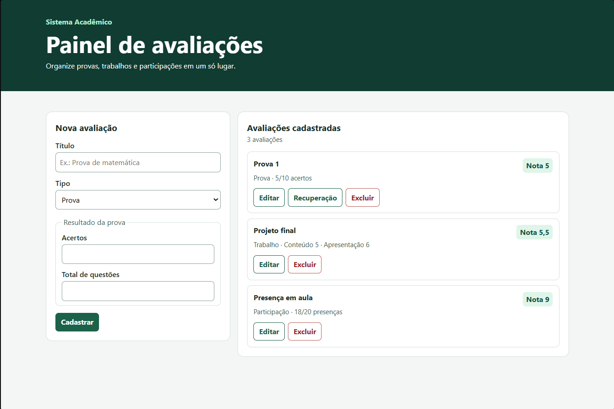
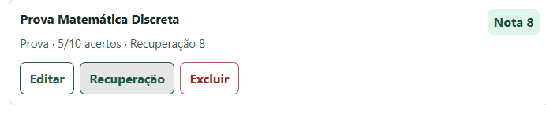
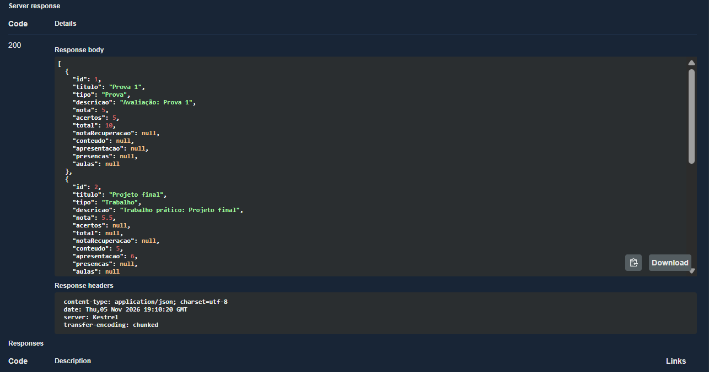

# Sistema Acadêmico

Aplicação para cadastrar avaliações acadêmicas, calcular notas em uma escala de 0 a 10 e registrar recuperações. O projeto começou como exercício de programação orientada a objetos e evoluiu para uma API ASP.NET Core com interface web, persistência local e testes de integração.

## Como executar

Requisito: [.NET 10 SDK](https://dotnet.microsoft.com/download/dotnet/10.0).

```bash
dotnet run --launch-profile http
```

- [Painel de avaliações](http://localhost:5125) para cadastrar, editar, excluir e registrar recuperação.
- [Swagger UI](http://localhost:5125/swagger) para explorar e testar a API no ambiente de desenvolvimento.

Na primeira execução, a aplicação apresenta uma prova, um trabalho e um registro de participação. Para demonstrar o fluxo, edite os acertos da prova de exemplo e registre uma recuperação de 8. Reinicie o servidor e consulte a prova novamente.

## Regras de cálculo

| Tipo | Cálculo | Validação |
| --- | --- | --- |
| Prova | Acertos ÷ total de questões × 10 | Total positivo e acertos entre zero e o total |
| Trabalho | Média das notas de conteúdo e apresentação | Cada nota entre 0 e 10 |
| Participação | Presenças ÷ total de aulas × 10 | Total positivo e presenças entre zero e o total |

A recuperação é exclusiva de provas. A nota final é a maior entre a nota original e a recuperação registrada. Um novo registro substitui a recuperação anterior. Editar uma prova preserva a recuperação enquanto o tipo continuar sendo prova. A API arredonda a nota final a duas casas decimais.

## API REST

| Método | Rota | Resultado |
| --- | --- | --- |
| GET | `/api/avaliacoes` | Lista as avaliações |
| GET | `/api/avaliacoes/{id}` | Consulta uma avaliação |
| POST | `/api/avaliacoes` | Cadastra uma avaliação e retorna `201 Created` |
| PUT | `/api/avaliacoes/{id}` | Atualiza os dados da avaliação |
| PUT | `/api/avaliacoes/{id}/recuperacao` | Registra ou substitui a nota de recuperação |
| DELETE | `/api/avaliacoes/{id}` | Exclui e retorna `204 No Content` |

O cadastro e a edição recebem `titulo`, `tipo` e os campos do tipo correspondente. Entradas inválidas retornam `400`, IDs ausentes retornam `404` e tentar registrar recuperação em trabalho ou participação retorna `409`.

```json
{
  "titulo": "Prova de matemática",
  "tipo": "Prova",
  "acertos": 7,
  "total": 10
}
```

O arquivo [SistemaAvaliacao.http](SistemaAvaliacao.http) inclui requisições para os três tipos e para as demais operações.

## Organização do código

- [Models](Models/) contém os tipos de avaliação. Cada tipo implementa sua própria fórmula por polimorfismo. A interface `IRecuperavel` representa a capacidade de receber recuperação.
- [Contracts](Contracts/) define os campos da API e valida os dados antes de criar os modelos.
- [Controllers](Controllers/) expõe as operações HTTP e traduz seus resultados em códigos de resposta.
- [Repositories](Repositories/) centraliza o armazenamento e serializa as alterações concorrentes dentro do processo.
- [wwwroot](wwwroot/) contém a interface responsiva em HTML, CSS e JavaScript, servida pela mesma aplicação.

Os dados são gravados em `App_Data/avaliacoes.json` na primeira alteração. O caminho pode ser configurado pela chave `Avaliacoes:Arquivo` ou pela variável de ambiente `Avaliacoes__Arquivo`. O armazenamento foi pensado para demonstração local, com uma instância do servidor. O painel usa dados compartilhados nessa instância e opera sem contas de usuário.

## Verificação automatizada

Com o .NET 10 SDK e o PowerShell 7.4 ou mais recente:

```bash
dotnet build -c Release
pwsh -NoProfile -File tests/Integracao.ps1
```

O script executa o servidor com um arquivo de dados temporário e verifica a interface servida, o OpenAPI, as fórmulas, as validações, as operações HTTP e a persistência após reinício. O workflow de integração do GitHub Actions roda a mesma verificação em pushes e pull requests.

## Telas do Sistema Acadêmico

### Painel de avaliações



### Recuperação de uma prova



### Consulta de avaliações no Swagger

A requisição `GET /api/avaliacoes` retorna a lista de avaliações cadastradas em JSON.


